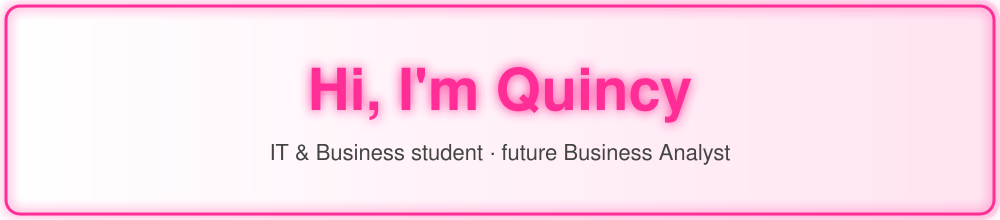

## About me

I'm a third-year Applied Computer Science student (IT & Business) at AP Hogeschool in Antwerp. I started out in orthopedagogy, so I learned to listen to people before I learned to code. I still work that way: talk to the client first, write the user stories, then help build it.

- 🛠️ **Vlotter**: a QA web app for a real client, built with Flutter, NestJS and PostgreSQL in two-week sprints
- 🌍 **Cardiff Met, 2026**: an educational TypeScript app about common childhood illnesses, made in an international team
- 🎯 **Goal**: IT consultancy
- 🥾 **Offline**: walking, hiking, reading, travelling

## Tech stack

  

## Contact

  

